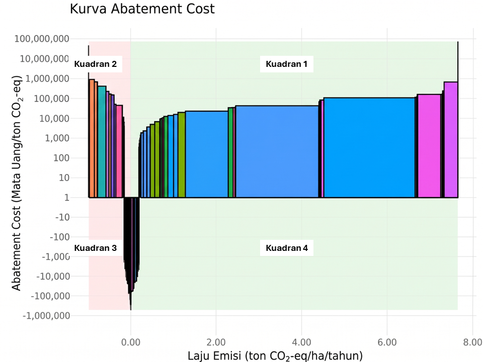

```{r setup, include=FALSE}
knitr::opts_chunk$set(echo = FALSE)
library(knitr)
library(kableExtra)
library(tidyr)
library(pkgdown)
library(ggplot2)
library(htmlwidgets)
library(DT)
library(scales)
library(leaflet)
library(mapview)
library(dplyr)
library(LUMENSR)
library(glue)

mapviewOptions(
  basemaps = c("Esri.WorldImagery",
               "Esri.WorldGrayCanvas",
               "Esri.WorldTopoMap",
               "OpenStreetMap")
)
```

<details><summary>Klik di sini untuk Log Analisis</summary>

```{r analysis-log, echo=FALSE}

analysis_log <- tribble(
  ~Category,                   ~Details,
  "Waktu Mulai Analisis",        params$start_time,
  "Waktu Selesai Analisis",      params$end_time,
  "Data Input dan Parameter", "",
  "Tutupan Lahan (T1)",      params$map1_file_path,
  "Tutupan Lahan (T2)",   params$map2_file_path,
  "Data Profitabilitas",   params$npv_file_path,
  "Tahun Tabel Profitabilitas", as.character(params$eae_year),
  "Peta Unit Perencanaan",   params$pu_file_path,
  "Data Unit Perencanaan",   params$pu_table_path,
  "Tahun 1", as.character(params$year1),
  "Tahun 2", as.character(params$year2),
  "Kelas Tutupan Lahan NoData", as.character(params$raster_nodata),
  "File Output", "",
  "Direktori Output",      paste0(getwd(), " | ", params$output_dir),
  "Ringkasan Sesi", "",
) %>% rbind(format_session_info_table())

analysis_log %>% kbl(caption = "Analysis Log", escape = FALSE) %>%
  kable_paper("hover", full_width = F )
```
</details>

# Pendahuluan

## Deskripsi Modul
Laporan ini menyajikan hasil Analisis Profitabilitas dan Trade-off berdasarkan skenario perubahan penggunaan lahan. Analisis menilai keuntungan finansial setiap tutupan lahan, lalu membandingkannya dengan perubahan stok karbon yang menyertai transisi lahan. Dengan cara ini, laporan menunjukkan apakah suatu perubahan lahan menguntungkan secara ekonomi, merugikan secara ekonomi, atau saling bertukar (trade-off) dengan penurunan emisi.
Analisis dilakukan dalam tiga tahap:

1.	**Profitabilitas**. Keuntungan setiap tutupan lahan dihitung sebagai Equal Annual Equivalent (EAE, `r params$currency`/ha/tahun), yaitu nilai tahunan ekuivalen dari Net Present Value (NPV). Selisih EAE antara dua periode (ΔEAE) menunjukkan perubahan profitabilitas akibat perubahan lahan.

2.	**Emisi dan sekuestrasi**. Selisih stok karbon antara tutupan lahan awal (T1) dan akhir (T2) dikonversi menjadi emisi atau sekuestrasi CO₂-eq (faktor 3,67).

3.	**Trade-off melalui abatement cost**. Abatement cost (biaya pengurangan emisi, `r params$currency`/ton CO₂-eq) menyatakan keuntungan yang dikorbankan untuk menurunkan satu ton CO₂-eq. Nilai ini dibandingkan dengan harga karbon untuk mengetahui berapa keuntungan ekonomi yang harus dikorbankan untuk menurunkan emisi, Nilai ini mendukung pengambilan keputusan terhadap tujuan ekonomi dan penurunan emisi.

4.  **Total Keuntungan Usaha Tani**

### Indikator Keuntungan

Indikator ekonomi yang digunakan adalah Nilai Tahunan Ekuivalen atau Equal Annual Equivalent (EAE). EAE adalah nilai tahunan yang setara dari Net Present Value (NPV) suatu tutupan lahan per satuan luas lahan. EAE mengubah seluruh nilai keuntungan bersih suatu tutupan lahan yang dihitung dalam bentuk NPV menjadi nilai rata-rata keuntungan tahunan yang ekuivalen yang telah terdiskonto. Suatu kegiatan dikatakan memiliki manfaat dan layak dijalankan bila EAE> 0. Indikator EAE digunakan untuk mengakomodir kemungkinan perbedaan siklus hidup tanaman di suatu tutupan lahan,  dengan rumus sebagai berikut:

$$
EAE = NPV \times \frac{i(1+i)^t}{(1+i)^t - 1}
$$
Keterangan:

- $EAE$ = Equal Annual Equivalent (nilai tahunan ekuivalen)
- $NPV$ = Net Present Value (nilai kini bersih)
- $i$ = Tingkat suku bunga riil (faktor diskonto)
- $t$ = Tahun ke-1, 2, 3, ..., $n$ selama periode analisis

Sedangkan Net Present Value (NPV) merupakan keuntungan atau pendapatan bersih saat ini yang didapat dari selisih antara penerimaan dengan biaya selama periode tertentu. NPV adalah penerimaan yang terdiskonto, dalam perhitungannya menggunakan faktor diskonto karena menormalkan nilai keuntungan di masa depan ke masa kini. Suatu kegiatan dikatakan memiliki manfaat dan layak dijalankan bila NPV > 0. Rumus NPV adalah:  

$$
NPV = \sum_{t=0}^{n}
\frac{B_t - C_t}{(1+i)^t}
$$
Keterangan:

- $B_t$ = Manfaat atau penerimaan pada tahun ke-$t$
- $C_t$ = Biaya pada tahun ke-$t$
- $t$ = Tahun ke-1, 2, 3, ..., $n$ selama periode analisis
- $i$ = Tingkat suku bunga riil (faktor diskonto)

Tingkat diskonto (discount factor) menggunakan tingkat suku bunga riil, dengan rumusan sebagai berikut:

$$
i = \frac{1 + \text{Nominal Interest Rate}}
{1 + \text{Inflation Rate}} - 1
$$

Nominal interest rate yang digunakan adalah suku bunga kredit bank umum untuk modal kerja, sedangkan inflation rate adalah tingkat inflasi tahunan. Asumsi harga input-output, suku bunga riil, dan tingkat inflasi tahunan yang digunakan adalah nilai dari tahun `r params$eae_year` baik untuk perhitungan T1 `r params$year1` maupun T2 `r params$year2`. Asumsi makro yang digunakan adalah data 10 tahun terakhir.

### Abatement Cost

Abatement Cost adalah besarnya keuntungan ekonomi yang dikorbankan untuk menurunkan satu ton CO₂-eq emisi akibat perubahan penggunaan lahan, dibandingkan kondisi dasar (baseline). Satuannya `r params$currency`/ton CO₂-eq. Nilai ini juga disebut biaya peluang (opportunity cost) pengurangan emisi.

Dalam konteks ekonomi lingkungan dan perubahan penggunaan lahan, abatement cost sering digunakan untuk menghitung:

•	biaya pengurangan emisi, 

•	trade-off antara keuntungan ekonomi dan penurunan emisi, 

Kurva biaya pengurangan emisi (abatement cost) menunjukkan perbandingan biaya peluang dari berbagai jenis perubahan penggunaan lahan dalam `r params$currency` per ton CO₂-eq dan menunjukkan kuantitas potensi pengurangan emisi per jenis perubahan penggunaan lahan, satuan yang digunakan adalah `r params$currency`/ton CO₂-eq. Kurva biaya pengurangan emisi (abatement cost) tidak menentukan siapa yang harus dibayar, tetapi memberikan perkiraan biaya peluang rata-rata dan marginal dari pengurangan emisi. Rumus untuk menghitung biaya peluang dalam `r params$currency`/ton CO₂-eq adalah:

$$
\frac{EAE_{T2} - EAE_{T1}}
{3.67 \left( C_{stok,T1} - C_{stok,T2} \right)}
=
\frac{\text{Opportunity Cost}}
{\text{Additional Carbon Stock}}
$$
Keterangan:

- $EAE_{T2}$ = Equal Annual Equivalent pada tutupan lahan T2
- $EAE_{T1}$ = Equal Annual Equivalent pada tutupan lahan T1
- $C_{stok,T1}$ = Stok karbon pada tutupan lahan T1
- $C_{stok,T2}$ = Stok karbon pada tutupan lahan T2

Berikut contoh kurva abatement cost yang memiliki 4 kuadran:



Sumbu X adalah abatement potential (ton CO₂-eq/tahun), dan sumbu Y adalah besarnya potensi pengurangan emisi per tahun (Semakin lebar balok, menandakan semakin besar kontribusi penurunan emisinya). Terdapat 4 kondisi yang akan disertakan contoh kasus untuk kempat hal ini:

1. Nilai abatement cost positif dan abatement potential positif: Kuadran 1

Kondisi yang memerlukan trade off analysis karena semakin tinggi abatement cost maka semakin kurang visible untuk project carbon, jika semakin rendah abatement cost maka semakin kurang layak untuk proyek karbon (layak bila abatement cost lebih rendah dari harga karbon).

2. Nilai abatement cost positif dan abatement potential negatif: Kuadran 2

Kondisi sequestrasi untuk carbon.

3. Nilai abatement cost negatif dan abatement potential positif: Kuadran 3

Biaya negatif, potensi positif: perubahan lahan menurunkan keuntungan sekaligus stok karbon, sehingga mencegahnya adalah win-win (no-regret mitigation). Contoh karet monokultur → lahan terbuka, −`r params$currency` 23,56/ton CO₂-eq.

4. Nilai abatement cost negatif dan abatement potential negatif: Kuadran 4

Biaya negatif, potensi negatif: perubahan lahan menaikkan keuntungan sekaligus stok karbon (win-win). Contoh Bungo: karet monokultur → kebun campur, −`r params$currency` 17,39/ton CO₂-eq.

## Cara Kerja Analisis
Alur kerja analisis melibatkan beberapa langkah kunci:

1. **Pemrosesan Data EAE**: Data EAE diproses untuk membuat tabel referensi yang komprehensif.

2. **Analisis Perubahan Penggunaan Lahan**: Peta perubahan penggunaan lahan diproses untuk menilai perubahan dalam EAE.

3. **Visualisasi**: Peta dihasilkan untuk merepresentasikan secara visual sebaran spasial dari perubahan EAE.

## Data yang Digunakan {.tabset}

### Peta Tutupan/Penggunaan Lahan pada `r params$year1`

```{r Land-Use/Cover Map T1, echo=FALSE, message=FALSE, warning=FALSE}
fill_scale <- ggplot2::scale_fill_manual(
  values = c(
    "#4E79A7", "#F28E2B", "#E15759", "#76B7B2", "#59A14F",
    "#EDC948", "#B07AA1", "#FF9DA7", "#9C755F", "#BAB0AC",
    "#86BCB6", "#FFB84D", "#A5C1DC", "#D37295", "#C4AD66",
    "#7B8D8E", "#B17B62", "#8CD17D", "#DE9D9C", "#5A5A5A",
    "#A0A0A0", "#D7B5A6", "#6D9EEB", "#E69F00", "#56B4E9",
    "#009E73", "#F0E442", "#0072B2", "#D55E00", "#CC79A7",
    "#999999", "#E51E10", "#FF7F00", "#FFFF33", "#A65628",
    "#F781BF", "#999933", "#8DD3C7", "#FFFFB3", "#BEBADA",
    "#FB8072", "#80B1D3", "#FDB462", "#B3DE69", "#FCCDE5",
    "#D9D9D9", "#BC80BD", "#CCEBC5", "#FFED6F", "#E41A1C"
  ),
  na.value = "white",
  name = "Tutupan Lahan",
  labels = function(x) stringr::str_wrap(x, width = 20)
)

lc1_map <- ggplot() +
  tidyterra::geom_spatraster(data = params$LULCT1) +
  fill_scale +
  guides(fill = guide_legend(ncol = 2, byrow = TRUE)) + 
  theme_bw() +
  theme(
    axis.title = element_blank(),
    panel.grid = element_blank(),
    legend.title = element_text(size = 8, face = "bold"),
    legend.text = element_text(size = 6),
    legend.key.height = unit(0.5, "cm"),
    legend.key.width = unit(0.4, "cm"),
    legend.position = "right",
    legend.justification = c(0, 0.5),
    legend.box.margin = margin(0, 0, 0, 0),
    legend.background = element_rect(fill = "lightgrey"),
    plot.title = element_text(hjust = 0.5, face = "bold")
  )

lc1_map
```

### Peta Tutupan/Penggunaan Lahan pada `r params$year2`

```{r Land-Use/Cover Map T2, echo=FALSE, message=FALSE, warning=FALSE}
fill_scale <- ggplot2::scale_fill_manual(
  values = c(
    "#4E79A7", "#F28E2B", "#E15759", "#76B7B2", "#59A14F",
    "#EDC948", "#B07AA1", "#FF9DA7", "#9C755F", "#BAB0AC",
    "#86BCB6", "#FFB84D", "#A5C1DC", "#D37295", "#C4AD66",
    "#7B8D8E", "#B17B62", "#8CD17D", "#DE9D9C", "#5A5A5A",
    "#A0A0A0", "#D7B5A6", "#6D9EEB", "#E69F00", "#56B4E9",
    "#009E73", "#F0E442", "#0072B2", "#D55E00", "#CC79A7",
    "#999999", "#E51E10", "#FF7F00", "#FFFF33", "#A65628",
    "#F781BF", "#999933", "#8DD3C7", "#FFFFB3", "#BEBADA",
    "#FB8072", "#80B1D3", "#FDB462", "#B3DE69", "#FCCDE5",
    "#D9D9D9", "#BC80BD", "#CCEBC5", "#FFED6F", "#E41A1C"
  ),
  na.value = "white",
  name = "Tutupan Lahan",
  labels = function(x) stringr::str_wrap(x, width = 20)
)

lc2_map <- ggplot() +
  tidyterra::geom_spatraster(data = params$LULCT2) +
  fill_scale + 
  guides(fill = guide_legend(ncol = 2, byrow = TRUE)) + 
  theme_bw() +
  theme(
    axis.title = element_blank(),
    panel.grid = element_blank(),
    legend.title = element_text(size = 8, face = "bold"),
    legend.text = element_text(size = 6),
    legend.key.height = unit(0.5, "cm"),
    legend.key.width = unit(0.4, "cm"),
    legend.position = "right",
    legend.justification = c(0, 0.5),
    legend.box.margin = margin(0, 0, 0, 0),
    legend.background = element_rect(fill = "lightgrey"),
    plot.title = element_text(hjust = 0.5, face = "bold")
  )

lc2_map
```

### Peta Unit Perencanaan

```{r Planning Unit, echo=FALSE, message=FALSE, warning=FALSE}
fill_scale <- ggplot2::scale_fill_manual(
  values = c(
    "#4E79A7", "#F28E2B", "#E15759", "#76B7B2", "#59A14F",
    "#EDC948", "#B07AA1", "#FF9DA7", "#9C755F", "#BAB0AC",
    "#86BCB6", "#FFB84D", "#A5C1DC", "#D37295", "#C4AD66",
    "#7B8D8E", "#B17B62", "#8CD17D", "#DE9D9C", "#5A5A5A",
    "#A0A0A0", "#D7B5A6", "#6D9EEB", "#E69F00", "#56B4E9",
    "#009E73", "#F0E442", "#0072B2", "#D55E00", "#CC79A7",
    "#999999", "#E51E10", "#FF7F00", "#FFFF33", "#A65628",
    "#F781BF", "#999933", "#8DD3C7", "#FFFFB3", "#BEBADA",
    "#FB8072", "#80B1D3", "#FDB462", "#B3DE69", "#FCCDE5",
    "#D9D9D9", "#BC80BD", "#CCEBC5", "#FFED6F", "#E41A1C"
  ),
  na.value = "white",
  name = "Unit Perencanaan",
  labels = function(x) stringr::str_wrap(x, width = 20)
)

pu_map <- ggplot() +
  tidyterra::geom_spatraster(data = params$PU) +
  fill_scale + 
  guides(fill = guide_legend(ncol = 2, byrow = TRUE)) + 
  theme_bw() +
  theme(
    axis.title = element_blank(),
    panel.grid = element_blank(),
    legend.title = element_text(size = 8, face = "bold"),
    legend.text = element_text(size = 6, lineheight = 0.9),
    legend.key.height = unit(0.5, "cm"),
    legend.key.width = unit(0.4, "cm"),
    legend.position = "right",
    legend.justification = c(0, 0.5),
    legend.box.margin = margin(0, 0, 0, 0),
    legend.background = element_rect(fill = "lightgrey"),
    plot.title = element_text(hjust = 0.5, face = "bold")
  )

pu_map
```

```{r pu-lookup-tab, echo=FALSE, message=FALSE, warning=FALSE, results='asis'}
if (!is.null(params$pu_table_path) && file.exists(params$pu_table_path)) {
  
  # Cetak judul tab secara manual jika menggunakan raster
  cat("### Tabel Acuan Unit Perencanaan\n\n")
  
  # Tampilkan datatable
  print(
    datatable(
      read_lookup_file(params$pu_table_path),
      extensions = c('Buttons', 'Responsive'),
      rownames = FALSE,
      options = list(
        paging = TRUE,
        searching = TRUE,
        fixedColumns = TRUE,
        autoWidth = TRUE,
        ordering = TRUE,
        dom = 'Blfrtip',
        buttons = list(
          list(extend = "copy",  className = "btn btn-light btn-sm"),
          list(extend = "csv",   className = "btn btn-light btn-sm"),
          list(extend = "excel", className = "btn btn-light btn-sm")
        )
      ),
      class = "display stripe hover"
    )
  )
}
```

### Tabel Acuan EAE

Tabel berikut menampilkan nilai EAE dan emisi karbon untuk setiap hektare lahan setiap tutupan lahan yang ada.

```{r NPV Lookup Table, echo=FALSE, message=FALSE, warning=FALSE}
npv_tbl <- read_lookup_file(params$npv_file_path) |>
  select(LC, EAE)

carbon_tbl <- read_lookup_file(params$cstock_table_path) |>
  select(LC, CARBON)

# join NPV + Carbon
npv_carbon_tbl <- npv_tbl |>
  left_join(carbon_tbl, by = "LC") |>
  mutate(
    CARBON = ifelse(is.na(CARBON), 0, CARBON)
  ) |>
  rename(
    `Tutupan Lahan` = LC,
    !!glue("EAE ({params$currency}/Ha/tahun)") := EAE,
    `Karbon (ton C/ha)` = CARBON
  ) |>
  mutate(
    across(where(is.numeric), easy_to_read_numbers)
  )

datatable(
  npv_carbon_tbl,
  extensions = c('Buttons', 'Responsive'),
  rownames = FALSE,
  options = list(
    paging = TRUE,
    searching = TRUE,
    fixedColumns = TRUE,
    autoWidth = TRUE,
    ordering = TRUE,
    dom = 'Blfrtip',
    buttons = list(
      list(extend = "copy",  className = "btn btn-light btn-sm"),
      list(extend = "csv",   className = "btn btn-light btn-sm"),
      list(extend = "excel", className = "btn btn-light btn-sm")
    )
  ),
  class = "display stripe hover"
)
```

# Hasil Analisis

## Ringkasan Keuntungan Usaha Tani

```{r, echo=FALSE, warning=FALSE, message=FALSE}
# Menghitung total luasan T1 dan T2
total_luas_area  <- sum(params$npv1_table$Total_Ha1, na.rm = TRUE)

# Menghitung total keuntungan T1 dan T2
total_untung_t1 <- sum(params$npv1_table$Total_NPV1, na.rm = TRUE)
total_untung_t2 <- sum(params$npv2_table$Total_NPV2, na.rm = TRUE)
```

Tabel ini menampilkan nilai ∆EAE (selisih EAE) dan total EAE untuk seluruh **tutupan lahan pada tahun satu `r params$year1` (T1) dan tahun kedua `r params$year2` (T2) di area seluas `r scales::label_comma()(total_luas_area )` Ha**. Tutupan lahan tanpa nilai komersial (hutan, semak, padang rumput, lahan terbuka, air) diberi EAE = 0. Nilai 0 berarti tidak ada keuntungan komersial yang dicatat, bukan tidak ada manfaat.

```{r, echo=FALSE, warning=FALSE, message=FALSE}
params$total_table %>%
  as.data.frame() %>%
  dplyr::mutate(dplyr::across(where(is.numeric), scales::label_comma())) %>%
  DT::datatable()
```

Tabel ini mengakomodir informasi jika terdapat perubahan luasan lahan pada setiap tutupan lahan diantara T1 (`r params$year1`) dengan T2 (`r params$year2`). Perubahan luasan lahan tersebut mempengaruhi besaran total EAE. **Asumsi harga input-output, suku bunga riil, dan tingkat inflasi tahunan yang digunakan adalah nilai dari tahun `r params$eae_year`**. baik untuk perhitungan T1 `r params$year1` maupun T2 `r params$year2`. Perbedaan luasan setiap tutupan lahan antara T1 dan T2 disajikan pada tabel dibawah ini:

```{r, echo=FALSE, warning=FALSE, message=FALSE}
eae_area_summary <- params$npv1_table %>%
  rename(LC = LC1) %>%
  full_join(
    params$npv2_table %>%
      rename(LC = LC2),
    by = "LC"
  ) %>%
  arrange(LC)

eae_area_summary %>%
  mutate(
    across(where(is.numeric), easy_to_read_numbers)
  ) %>%
  rename(
    `Tutupan Lahan` = LC,
    !!glue::glue("Total Keuntungan Usaha Tani T1 ({params$currency}/tahun)") := Total_NPV1,
    !!glue::glue("Total Luas Lahan T1 ({params$year1}) (Ha)") := Total_Ha1,
    !!glue::glue("Total Keuntungan Usaha Tani T2 ({params$currency}/tahun)") := Total_NPV2,
    !!glue::glue("Total Luas Lahan T2 ({params$year2}) (Ha)") := Total_Ha2
  ) %>%
  DT::datatable(
    rownames = FALSE,
    extensions = c("Buttons", "Responsive"),
    options = list(
      paging = TRUE,
      searching = TRUE,
      fixedColumns = TRUE,
      autoWidth = TRUE,
      ordering = TRUE,
      dom = "Blfrtip",
      buttons = list(
        list(extend = "copy", className = "btn btn-light btn-sm"),
        list(extend = "csv",  className = "btn btn-light btn-sm"),
        list(extend = "excel",className = "btn btn-light btn-sm")
        )
    )
  )
```

## Keuntungan Usaha Tani untuk Tahun `r params$year1` {.tabset}
Bagian ini menyajikan sepuluh kategori tutupan lahan dengan total EAE tertinggi pada tahun `r params$year1`. EAE mewakili indikator keuntungan bersih suatu tutupan lahan yang ekuivalen dengan rataan NPV per tahun yang terdiskonto. EAE untuk tahun T1: `r params$year1` merupakan hasil perhitungan yang didapat dari asumsi biaya input-output, suku bunga riil, dan tingkat inflasi tahunan dari tahun `r params$eae_year`.

### Grafik
```{r, echo=FALSE, warning=FALSE, message=FALSE}
params$npv1_chart
```

### Peta Distribusi
```{r, echo=FALSE, warning=FALSE, message=FALSE}
r1 <- shrink_raster(params$npv1_map)

mapview(
  r1,
  maxpixels = terra::ncell(r1),   # jangan di-resample lagi
  na.color = "transparent",
  layer.name = "EAE T1",
  col.regions = colorRampPalette(c("lightgrey", "darkgreen")),
  map.type = "Esri.WorldGrayCanvas"
)
```

### Tabel
```{r, echo=FALSE, warning=FALSE, message=FALSE}
fluidRow(
  column(6, 
    div(class = "card text-white bg-success mb-3", style = "max-width: 100%;",
        div(class = "card-header", "Total Luas Area Kajian"),
        div(class = "card-body", 
            h4(class = "card-title", paste0(scales::label_comma()(total_luas_area), " Ha")))
    )
  ),
  column(6, 
    div(class = "card text-white bg-primary mb-3", style = "max-width: 100%;",
        div(class = "card-header", "Total Keuntungan Usaha Tani T1"),
        div(class = "card-body", 
            h4(class = "card-title", paste0(params$currency, " ", scales::label_comma()(total_untung_t1))))
    )
  )
)

params$npv1_table %>%
  dplyr::mutate(dplyr::across(where(is.numeric), easy_to_read_numbers)) %>%
  rename(
    `Tutupan Lahan 1` = LC1,
    !!glue::glue("Total Keuntungan Usaha Tani ({params$currency}/tahun)") := Total_NPV1,
    `Total Luas (Ha)` = Total_Ha1
  ) %>%
  DT::datatable(
    rownames = FALSE,
    extensions = c('Buttons', 'Responsive'),
    options = list(
      paging = TRUE,
      searching = TRUE,
      fixedColumns = TRUE,
      autoWidth = TRUE,
      ordering = TRUE,
      dom = 'Blfrtip',
      buttons = list(
        list(extend = "copy", className = "btn btn-light btn-sm"),
        list(extend = "csv",  className = "btn btn-light btn-sm"),
        list(extend = "excel",className = "btn btn-light btn-sm")
        )
    ),
    class = "display stripe hover"
    )
```

## Keuntungan Usaha Tani untuk Tahun `r params$year2` {.tabset}
Bagian ini menyajikan sepuluh kategori tutupan lahan dengan total EAE tertinggi pada tahun `r params$year2` EAE mewakili indikator keuntungan bersih suatu tutupan lahan yang ekuivalen dengan rataan NPV per tahun yang terdiskonto. EAE untuk tahun T2: `r params$year2` merupakan hasil perhitungan yang didapat dari asumsi biaya input-output, suku bunga riil, dan tingkat inflasi tahunan dari tahun `r params$eae_year`. 

### Grafik
```{r, echo=FALSE, warning=FALSE, message=FALSE}
params$npv2_chart
```

### Peta Distribusi
```{r, echo=FALSE, warning=FALSE, message=FALSE}
r2 <- shrink_raster(params$npv2_map)

mapview(
  r1,
  maxpixels = terra::ncell(r2),   # jangan di-resample lagi
  na.color = "transparent",
  layer.name = "EAE T2",
  col.regions = colorRampPalette(c("lightgrey", "darkgreen")),
  map.type = "Esri.WorldGrayCanvas"
)
```

### Tabel
```{r, echo=FALSE, warning=FALSE, message=FALSE}
fluidRow(
  column(6, 
    div(class = "card text-white bg-success mb-3", style = "max-width: 100%;",
        div(class = "card-header", "Total Luas Area Kajian"),
        div(class = "card-body", 
            h4(class = "card-title", paste0(scales::label_comma()(total_luas_area), " Ha")))
    )
  ),
  column(6, 
    div(class = "card text-white bg-primary mb-3", style = "max-width: 100%;",
        div(class = "card-header", "Total Keuntungan Usaha Tani T2"),
        div(class = "card-body", 
            h4(class = "card-title", paste0(params$currency, " ", scales::label_comma()(total_untung_t2))))
    )
  )
)

params$npv2_table %>%
  dplyr::mutate(dplyr::across(where(is.numeric), easy_to_read_numbers)) %>%
  rename(
    `Tutupan Lahan 2` = LC2,
    !!glue::glue("Total Keuntungan Usaha Tani ({params$currency}/tahun)") := Total_NPV2,
    `Total Luas (Ha)` = Total_Ha2
  ) %>%
  DT::datatable(
    rownames = FALSE,
    extensions = c('Buttons', 'Responsive'),
    options = list(
      paging = TRUE,
      searching = TRUE,
      fixedColumns = TRUE,
      autoWidth = TRUE,
      ordering = TRUE,
      dom = 'Blfrtip',
      buttons = list(
        list(extend = "copy", className = "btn btn-light btn-sm"),
        list(extend = "csv",  className = "btn btn-light btn-sm"),
        list(extend = "excel",className = "btn btn-light btn-sm")
        )
    ),
    class = "display stripe hover"
    )
```

## Delta Keuntungan Usaha Tani dari Tahun `r params$year1` sampai `r params$year2` {.tabset}
Bagian ini menyajikan 10 urutan tertinggi perubahan EAE (ΔEAE) antara tahun `r params$year1` dan `r params$year2`. ΔEAE mencerminkan perbedaan dalam proyeksi imbal hasil ekonomi dari penggunaan lahan di dua periode waktu. Nilai ΔEAE positif menunjukkan peningkatan profitabilitas dari perubahan suatu tutupan lahan pada T1 menjadi suatu tutupan lahan pada T2, sementara nilai negatif menunjukkan terdapat penurunan profitabilitas dari perubahan suatu tutupan lahan pada T1 menjadi suatu tutupan lahan pada T2.

### Grafik
```{r, echo=FALSE, warning=FALSE, message=FALSE}
params$deltaNPV_chart
```

### Peta Distribusi
```{r, echo=FALSE, warning=FALSE, message=FALSE}
r_delta <- shrink_raster(params$deltaNPV_map, target = 3e5, fun = "modal")

# Breakpoints dari raster yang sudah diperkecil
vals    <- terra::values(r_delta, na.rm = TRUE)
min_val <- min(vals)
max_val <- max(vals)

# Tiga kelas: negatif, nol, positif.
# pmin/pmax menjaga breaks tetap naik monoton walau data tidak punya
# nilai negatif atau positif sama sekali (kalau tidak, mapview akan error).
breaks <- c(pmin(min_val, -1e-9), -1e-10, 1e-10, pmax(max_val, 1e-9))

colors <- c("red", "lightgrey", "green")  # negatif, nol, positif

mapview(
  r_delta,
  maxpixels   = terra::ncell(r_delta),  # jangan di-resample lagi
  na.color    = "transparent",
  layer.name  = "Delta EAE",
  at          = breaks,
  col.regions = colors,
  map.type    = "Esri.WorldGrayCanvas"
)
```

### Tabel
```{r, echo=FALSE, warning=FALSE, message=FALSE}
params$deltaNPV_table %>%
  dplyr::mutate(dplyr::across(where(is.numeric), easy_to_read_numbers)) %>%
  rename(
    `Perubahan Penggunaan Lahan` = LULCC,
    !!rlang::sym(glue::glue("ΔKeuntungan Usaha Tani ({params$currency}/tahun)")) := Total_deltaNPV,
    !!rlang::sym(glue::glue("|ΔKeuntungan Usaha Tani| ({params$currency}/tahun)")) := Total_abs_deltaNPV,
    `Total Luas (Ha)` = Total_Ha2
  ) %>%
  DT::datatable(
    rownames = FALSE,
    extensions = c('Buttons', 'Responsive'),
    options = list(
      paging = TRUE,
      searching = TRUE,
      fixedColumns = TRUE,
      autoWidth = TRUE,
      ordering = TRUE,
      dom = 'Blfrtip',
      buttons = list(
        list(extend = "copy", className = "btn btn-light btn-sm"),
        list(extend = "csv",  className = "btn btn-light btn-sm"),
        list(extend = "excel",className = "btn btn-light btn-sm")
        )
    ),
    class = "display stripe hover"
    )
```

### Kurva Abatement Cost (Emisi)
```{r, echo=FALSE, warning=FALSE, message=FALSE}
params$emission_plot
```

### Kurva Abatement Cost (Sekuestrasi)
```{r, echo=FALSE, warning=FALSE, message=FALSE}
params$sequestration_plot
```

## Analsis per Unit Perencanaan
```{r child_documen_traj_fao, echo=FALSE, fig.keep='all', results='asis'}
render_child_pu <- function(results_list, pu_name, currency) {
  env <- new.env()
  env$results_list <- results_list
  env$pu_name <- pu_name
  env$currency <- currency
  env$easy_to_read_numbers <- easy_to_read_numbers
  
  # Cek apakah PU ini memiliki nilai EAE (T1 atau T2) yang valid
  total_vals <- as.data.frame(results_list[[pu_name]][['total_values']])
  has_valid_eae <- any(total_vals$Nilai != 0, na.rm = TRUE)
  
  # Cek apakah data grafik benar-benar tersedia
  has_lulcc_bar <- !is.null(results_list[[pu_name]][['lulcc_bar']]) && has_valid_eae
  has_lc1_bar   <- !is.null(results_list[[pu_name]][['lc1_bar']]) && has_valid_eae
  has_lc2_bar   <- !is.null(results_list[[pu_name]][['lc2_bar']]) && has_valid_eae
  has_abatement <- !is.null(params$abatement_pu_plots[[pu_name]])
  
  # Inisialisasi list konten dengan Tab Utama
  child_content <- c(
    paste0("### ", pu_name, " {.tabset}")
  )
  
  # 1. Tambahkan Tab ΔEAE
  if (has_lulcc_bar) {
    child_content <- c(child_content,
      "",
      paste0("#### Top 10 ΔKeuntungan Usaha Tani di ", pu_name),
      "```{r}",
      "#| echo: false",
      "results_list[[pu_name]][['lulcc_bar']]",
      "```"
    )
  }
  
  # 2. Tambahkan Tab Tabel Nilai Total
  if (has_valid_eae) {
    child_content <- c(child_content,
      "",
      paste0("#### Tabel Nilai Total untuk ", pu_name),
      "```{r}",
      "#| echo: false",
      "total_luas_pu <- sum(results_list[[pu_name]][['all_dissolved_lulcc_pu']]$Total_Ha2, na.rm = TRUE)",
      "fluidRow(",
      "  column(12,",
      "    div(class = 'card text-white bg-success mb-3', style = 'max-width: 100%;',",
      "        div(class = 'card-header', 'Total Luas Area'),",
      "        div(class = 'card-body',",
      "            h4(class = 'card-title', paste0(scales::label_comma()(total_luas_pu), ' Ha')))",
      "    )",
      "  )",
      ")",
      "```",
      "",
      "```{r}",
      "#| echo: false",
      "as.data.frame(results_list[[pu_name]][['total_values']]) %>%",
      "  mutate_if(is.numeric, easy_to_read_numbers) %>%",
      "  kable() %>%",
      "  kable_styling(bootstrap_options = c('striped', 'hover'))",
      "```"
    )
  }
  
  # 3. Tambahkan Tab EAE LC1
  if (has_lc1_bar) {
    child_content <- c(child_content,
      "",
      paste0("#### Top 10 Keuntungan Usaha Tani berdasarkan Tutupan Lahan 1 di ", pu_name),
      "```{r}",
      "#| echo: false",
      "results_list[[pu_name]][['lc1_bar']]",
      "```"
    )
  }
  
  # 4. Tambahkan Tab EAE LC2
  if (has_lc2_bar) {
    child_content <- c(child_content,
      "",
      paste0("#### Top 10 Keuntungan Usaha Tani berdasarkan Tutupan Lahan 2 di ", pu_name),
      "```{r}",
      "#| echo: false",
      "results_list[[pu_name]][['lc2_bar']]",
      "```"
    )
  }
  
  # 5. Tambahkan Tab Seluruh Transisi LULCC (Selalu ditampilkan)
  child_content <- c(child_content,
    "",
    paste0("#### Seluruh Transisi LULCC di ", pu_name),
    "```{r}",
    "#| echo: false",
    "results_list[[pu_name]][['all_dissolved_lulcc_pu']] %>%",
    "  dplyr::mutate(dplyr::across(where(is.numeric), easy_to_read_numbers)) %>%",
    "  dplyr::rename(",
    "    `Perubahan Penggunaan Lahan` = LULCC,",
    sprintf("    `ΔKeuntungan Usaha Tani (%s)` = Total_deltaNPV,", currency),
    sprintf("    `|ΔKeuntungan Usaha Tani| (%s)` = Total_abs_deltaNPV,", currency),
    "    `Total Luas (Ha)` = Total_Ha2",
    "  ) %>%",
    "  DT::datatable(",
    "    rownames = FALSE,",
    "    extensions = c('Buttons', 'Responsive'),",
    "    options = list(",
    "      paging = TRUE,",
    "      searching = TRUE,",
    "      fixedColumns = TRUE,",
    "      autoWidth = TRUE,",
    "      ordering = TRUE,",
    "      dom = 'Blfrtip',",
    "      buttons = list(",
    "        list(extend = 'copy', className = 'btn btn-light btn-sm'),",
    "        list(extend = 'csv',  className = 'btn btn-light btn-sm'),",
    "        list(extend = 'excel', className = 'btn btn-light btn-sm')",
    "      )",
    "    ),",
    "    class = 'display stripe hover'",
    "  )",
    "```"
  )
  
  # 6. Tambahkan Tab Kurva Abatement
  if (has_abatement) {
    child_content <- c(child_content,
      "",
      paste0("#### Kurva Abatement per Perubahan Lahan di ", pu_name),
      "```{r}",
      "#| echo: false",
      "params$abatement_pu_plots[[pu_name]]",
      "```"
    )
  }
  
  # Knit the child document
  res <- knitr::knit_child(
    text = child_content,
    envir = env,
    quiet = TRUE
  )
  
  cat(res, sep = "\n")
}

for (pu_name in names(params$pu_outputs)) {
  render_child_pu(params$pu_outputs, pu_name, params$currency)
}
```

# Kesimpulan
Laporan ini memberikan wawasan berharga mengenai kinerja keuangan dari berbagai jenis dan transisi penggunaan lahan. Dengan mengkuantifikasi imbal hasil ekonomi dari waktu ke waktu, analisis ini membantu mengidentifikasi penggunaan lahan mana yang memberikan profitabilitas terbesar di bawah berbagai skenario.

Hasil analisis menekankan pentingnya mempertimbangkan aspek keuangan dalam perencanaan penggunaan lahan. Dengan menyediakan visualisasi yang jelas dan data komparatif, analisis ini mendukung para pengambil keputusan dalam mengevaluasi investasi berbasis lahan dan menyelaraskan tujuan pembangunan dengan pertimbangan ekonomi.

**Profitabilitas**. Nilai Equal Annual Equivalent (EAE) menunjukkan tutupan lahan yang paling menguntungkan pada tahun awal (T1) dan akhir (T2), sedangkan ΔEAE menunjukkan perubahan keuntungan akibat perubahan tutupan lahan. Total ΔEAE lanskap dan per unit perencanaan menunjukkan di mana keuntungan meningkat atau menurun.

**Trade-off keuntungan dan emisi**. Abatement cost menyatakan keuntungan yang dikorbankan untuk setiap ton CO₂-eq yang dihindari. Kurva abatement cost mengurutkan perubahan lahan dari yang paling murah sampai paling mahal untuk dikurangi emisinya, dan lebar balok menunjukkan besar potensi pengurangan emisinya. Hasilnya dibaca menurut kuadran:

- **Kuadran 1 (biaya positif, emisi)**: perubahan lahan menambah keuntungan tetapi melepas karbon. Transisi dengan abatement cost rendah dan potensi besar adalah prioritas untuk dikendalikan karena pengorbanan keuntungannya kecil.

- **Kuadran 2 (biaya positif, sekuestrasi)**: penambahan stok karbon membutuhkan pengorbanan keuntungan.

- **Kuadran 3 dan 4 (biaya negatif)**: perubahan lahan menurunkan emisi atau mencegahnya tanpa mengorbankan keuntungan (win-win), sehingga dapat didahulukan.

<div style="font-size: 10pt;">

**Referensi**

*   Dewi, S., Ekadinata, A., Rahmanulloh, A., Khasanah, N., Rahayu, S., van Noordwijk, M., & Budidarsono, S. (2012). *The carbon efficiency of oil palm plantations: an opportunity cost analysis* (Technical Brief No. 28). World Agroforestry Centre (ICRAF) Southeast Asia Regional Office.
*   Suyanto, S., Ekadinata, A., Sofiyuddin, M., & Rahmanulloh, A. (2014). Opportunity Costs of Emissions Caused by Land-Use Changes. *Open Journal of Forestry*, *4*(1), 85–90. https://doi.org/10.4236/ojf.2014.41013
*   Rahmanulloh, A., Sofiyuddin, M., & Suyanto, S. (2013). *Seri Agroforestri dan Kehutanan di Sulawesi: Profitabilitas sistem penggunaan lahan di Sulawesi Selatan dan Sulawesi Tenggara* (Working Paper No. 166). World Agroforestry Centre (ICRAF) Southeast Asia Regional Program. https://doi.org/10.5716/WP13042.PDF
*   Sofiyuddin, M., Rahmanulloh, A., & Suyanto, S. (2012). Assessment of Profitability of Land Use Systems in Tanjung Jabung Barat District, Jambi Province, Indonesia. *Open Journal of Forestry*, *2*(4), 252–256. https://doi.org/10.4236/ojf.2012.24031

</div>

------------------------------------------------------------------------

<font size="1"> LUMENS adalah perangkat lunak gratis dan disediakan TANPA JAMINAN APA PUN. Pengguna bertanggung jawab atas hasil yang dibuat. Hasil bergantung pada kualitas data input ("garbage in, garbage out") dan dapat bervariasi atau sensitif terhadap parameter yang digunakan. Laporkan masalah yang ditemui saat menggunakan LUMENS sebagai [a GitHub issue](https://github.com/icraf-indonesia/lumens-shiny/issues). Umpan balik dan pertanyaan dipersilakan [Contact Us](mailto:lumens@cifor-icraf.org). </font size>
